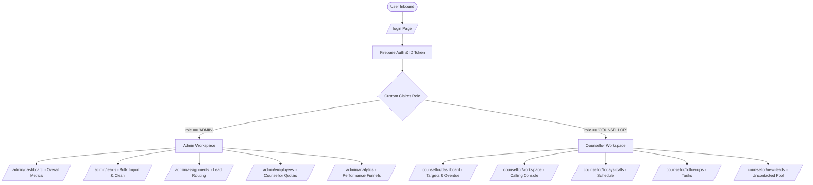

# System Architecture & Technical Overview
## Salem Foundations — Employee Management & Counsellor Lead Calling System

---

## 1. Executive Summary & Purpose

### What is this Tool?
The **Salem Foundations Employee Management & Lead Calling System** is a purpose-built CRM and **Preview/Progressive Tele-calling Console** designed for educational institutions and foundation outreach teams. It bridges the gap between raw student/lead inquiries (collected via school campaigns, online registrations, and bulk surveys) and admissions counsellors who conduct tele-counselling.

### Primary Objectives
1. **Lead Ingestion & Deduplication:** Ingest raw CSV and Excel data, validate 10-digit mobile numbers, remove duplicates, and organize leads into pipelines (`BULK`, `APPLICATION`).
2. **Intelligent Lead Distribution:** Distribute leads to counsellors manually, by criteria filters, or via automated load-balanced assignment.
3. **Counsellor Tele-Calling Console:** Provide an agent interface featuring **Next Best Action** recommendations, one-click dialing, live duration timers, WhatsApp collateral sharing, and mandatory structured call dispositions.
4. **Pipeline Tracking & Task Management:** Prevent lead leakage by automatically converting call outcomes (e.g. `INTERESTED`, `CALL_LATER`) into scheduled follow-up tasks with calendar alerts.
5. **Administrative Analytics:** Track counsellor daily call quotas, connection rates, conversion metrics, and activity logs.

---

## 2. Technology Stack & Dependencies

```
┌────────────────────────────────────────────────────────────────────────┐
│                               FRONTEND                                 │
│  Next.js 16 (App Router, Turbopack) • React 18/19 • TypeScript 5       │
│  Tailwind CSS • Lucide Icons • React Hot Toast • Date-fns • Clsx      │
└──────────────────────────────────┬─────────────────────────────────────┘
                                   │ HTTP (JSON / Bearer Token)
┌──────────────────────────────────▼─────────────────────────────────────┐
│                            BACKEND / API                               │
│  Next.js Node API Route Handlers (/api/*)                              │
│  Server-side Authentication & RBAC (Bearer ID Token Verification)      │
│  PapaParse & XLSX (Spreadsheet Stream Parsing)                         │
└──────────────────────────────────┬─────────────────────────────────────┘
                                   │ Google Cloud Admin SDK
┌──────────────────────────────────▼─────────────────────────────────────┐
│                       PERSISTENCE & SECURITY                           │
│  Google Cloud Firestore (Live NoSQL DB)                                │
│  Firebase Authentication (Email / Password + Custom Claims)            │
│  Dual-Mode Config (USE_MOCK_DATA toggle for offline demo mode)         │
└────────────────────────────────────────────────────────────────────────┘
```

| Layer | Technology | Version | Purpose |
| :--- | :--- | :--- | :--- |
| **Framework** | Next.js | `^16.2.6` / `16.4.5` | App Router, SSR, Turbopack dev server, edge API routes |
| **Language** | TypeScript | `^5.0.0` | Strict static typing across domain models and API contracts |
| **UI Library** | React | `^18.0.0` | Client components, hooks, state management |
| **Styling** | Tailwind CSS | `^3.4.1` | Utility-first responsive design, modal docks, dashboard grids |
| **Icons** | Lucide React | `^0.562.0` | UI iconography (telephony, calendar, statuses, navigation) |
| **File Parsing** | `xlsx` & `papaparse` | `0.18.5` / `5.5.3` | Client and server parsing of bulk student CSV/Excel lists |
| **Auth (Client)**| Firebase Client SDK | `^12.8.0` | Client-side `signInWithEmailAndPassword`, session observers |
| **Auth (Server)**| Firebase Admin SDK | `^10.3.0` | Cryptographic JWT token verification, custom claims management |
| **Database** | Google Cloud Firestore | `^10.3.0` | NoSQL document database storing leads, tasks, and call outcomes |
| **Messaging** | WhatsApp Deep-linking | Native `wa.me` | Instant template messaging via device WhatsApp protocol |

---

## 3. System Architecture & Role-Based Access Control (RBAC)

The application enforces a strict two-role separation authenticated via **Firebase Auth Custom Claims**:



### Security & Access Control Policies

* **`ADMIN`:** Full read/write access to all collections. Can upload leads, delete records, reassign leads, provision employee accounts, set daily call quotas, and access administrative routes (`/admin/*`).
* **`COUNSELLOR`:** Scoped access. Allowed only to read and write leads assigned to their unique `employeeId` (or claim unassigned leads during auto-dialing). Blocked from administrative employee management and global deletions.
* **Server-side Guard Middleware (`src/lib/server-auth.ts`):**
  * `requireAuth(request)`: Validates `Authorization: Bearer <token>`, verifies signature via `adminAuth.verifyIdToken()`, extracts custom claims.
  * `requireAdmin(request)`: Verifies authentication and ensures `role === 'ADMIN'`. Returns `403 Forbidden` if a non-admin attempts access.

---

## 4. End-to-End Data Flow

### 4.1 Bulk Lead Import & Deduplication Flow

```mermaid
sequenceDiagram
    autonumber
    actor Admin as Admin User
    participant Client as /admin/leads UI
    participant API as POST /api/leads/import
    participant DB as Cloud Firestore (leads collection)

    Admin->>Client: Uploads CSV / Excel file
    Client->>Client: Parses headers, normalizes columns (name, mobile, course, district)
    Client->>API: Sends JSON array of leads with Bearer Token
    API->>API: Validates session via requireAdmin()
    API->>API: Filters rows; strictly verifies 10-digit mobile format
    API->>DB: Queries existing mobiles in batches of 30 (where 'mobile' in chunk)
    DB-->>API: Returns existing mobile numbers
    API->>API: Deduplicates against DB and in-batch duplicates
    loop In chunks of 400 (under Firestore 500 limit)
        API->>DB: batch.set() new lead documents (status: 'NEW', currentStage: 'NEW')
        API->>DB: batch.commit()
    end
    API-->>Client: Returns { success: true, added: N, skipped: M, invalidRows: [...] }
    Client-->>Admin: Displays success banner & imports leads into table
```

### 4.2 Lead Tele-Calling & Disposition Flow

```mermaid
sequenceDiagram
    autonumber
    actor Agent as Counsellor
    participant Console as CallingConsole.tsx
    participant Engine as Next Best Action (nextBestAction.ts)
    participant OutcomesAPI as POST /api/call-outcomes
    participant LeadsAPI as PATCH /api/leads/[id]
    participant DB as Firestore (leads, call_outcomes, tasks, activities)

    Agent->>Console: Opens Calling Workspace
    Console->>Engine: getNextLead(assignedLeads)
    Engine-->>Console: Returns Top Priority Lead (Overdue > Today's Followup > New High Priority)
    Console->>LeadsAPI: PATCH /api/leads/[id] { lockDialing: true }
    LeadsAPI->>DB: Acquires 3-minute atomic dialing lock (dialingLockUntil, dialingLockBy)
    
    Agent->>Console: Clicks "START CALLING NOW"
    Console->>Console: Transition to 'inCall' state; live duration timer starts (00:01, 00:02...)
    opt Collateral Sharing
        Agent->>Console: Clicks WhatsApp Quick-Send (Brochure / Fees / Link)
        Console->>Console: Launches wa.me deep-link with pre-formatted message
    end
    Agent->>Console: Clicks "End Call"
    Console->>Console: Transition to 'outcome' modal; timer stops
    Agent->>Console: Selects outcome (e.g. 'Interested' or 'Call Later') + inputs notes
    Console->>Console: Transitions to 'scheduling' screen; agent selects follow-up slot
    
    Console->>OutcomesAPI: POST /api/call-outcomes { leadId, outcome, duration, notes, nextCallDate }
    OutcomesAPI->>DB: 1. Add record in 'call_outcomes'
    OutcomesAPI->>DB: 2. Update 'leads' (status: 'INTERESTED', nextFollowUp, lastOutcome)
    OutcomesAPI->>DB: 3. Add follow-up record in 'tasks' (status: 'PENDING', dueDate)
    OutcomesAPI->>DB: 4. Append entry to 'activities' timeline
    OutcomesAPI-->>Console: 201 Created
    Console->>Console: Advances automatically to next lead in queue
```

---

## 5. UI / UX Design & Screen Breakdown

The UI is built with a mobile-first, high-contrast aesthetic using Tailwind CSS:

### 1. Admin Experience
* **Dashboard (`/admin/dashboard`):** High-level KPI cards displaying Total Leads, Contacted Rate, Qualified Count, and Today's Call Activity. Includes counsellor leaderboard tracking calls made against daily targets.
* **Leads Workspace (`/admin/leads`):** Searchable, filterable datagrid with multi-column sorting (Status, Priority, Course, Location). Contains the Bulk File Upload modal supporting `.csv`, `.xlsx`, and `.xls` files with preview and column mapping.
* **Lead Assignment (`/admin/assignments`):** Multi-select lead distribution tool allowing bulk manual assignment, percentage split across active staff, or filtered batch routing.
* **Employee Management (`/admin/employees`):** Administrative view to invite counsellors, assign system roles (`ADMIN` / `COUNSELLOR`), adjust daily call quotas, and toggle account activation status.

### 2. Counsellor Tele-Calling Experience
* **Counsellor Dashboard (`/counsellor/dashboard`):** Personal metric center displaying today's progress bar toward daily call targets (e.g., `18 / 25 Calls Completed`), pending follow-ups badge, and hot leads.
* **Calling Console (`src/components/counsellor/CallingConsole.tsx`):**
  * **Lead Hero Card:** Dynamic color gradients based on lead temperature (`hot` = red/orange, `warm` = amber/orange, `cold` = blue/indigo). Displays student name, 10-digit phone, course interest, location, conversion probability score, and overdue indicators.
  * **Calling State Machine:**
    1. `ready`: Displays lead card, history, WhatsApp quick-links, and "Start Calling" trigger.
    2. `calling`: Outbound ringing animation with call state indicators.
    3. `inCall`: Minimal distraction screen showing caller name, course, and a large tabular-num duration timer.
    4. `outcome`: Structured outcome selector (`Interested`, `Not Interested`, `No Response`, `Call Later`, `Wrong Number`) with mandatory notes field.
    5. `scheduling`: Calendar slot selector (`Today`, `Tomorrow`, `This Week`, `Next Week`) mapping directly into calendar tasks.
  * **WhatsApp Quick-Send Dock:** One-tap triggers for `📄 Brochure`, `💰 Fee Details`, `📸 Campus Photos`, and `🎯 Application Link`.

---

## 6. Backend API Routes & Database Schema

### 6.1 Database Schema (Firestore Collections)

```
Firestore Database
├── employees/ {employeeId}
│   ├── email: string
│   ├── name: string
│   ├── phone: string
│   ├── role: 'ADMIN' | 'COUNSELLOR'
│   ├── isActive: boolean
│   ├── dailyCallTarget: number
│   ├── createdAt: Timestamp
│   └── updatedAt: Timestamp
│
├── leads/ {leadId}
│   ├── name: string
│   ├── mobile: string (10 digits)
│   ├── email: string | null
│   ├── course: string | null
│   ├── location: string | null
│   ├── source: 'BULK' | 'APPLICATION'
│   ├── priority: 'HIGH' | 'MEDIUM' | 'LOW'
│   ├── status: 'NEW' | 'CONTACTED' | 'INTERESTED' | 'NOT_INTERESTED' | 'CONVERTED'
│   ├── currentStage: 'NEW' | 'CONTACTED' | 'QUALIFIED' | 'UNQUALIFIED' | 'CONVERTED'
│   ├── assignedEmployeeId: string | null
│   ├── nextFollowUp: Timestamp | null
│   ├── lastOutcome: string | null
│   ├── lastCallDuration: number
│   ├── dialingLockUntil: Timestamp | null
│   ├── dialingLockBy: string | null
│   └── createdAt / updatedAt: Timestamp
│
├── tasks/ {taskId}
│   ├── leadId: string
│   ├── employeeId: string
│   ├── taskType: 'CALL' | 'FOLLOW_UP' | 'DOCUMENT'
│   ├── description: string
│   ├── dueDate: Timestamp
│   ├── status: 'PENDING' | 'COMPLETED' | 'OVERDUE'
│   └── createdAt / updatedAt: Timestamp
│
├── call_outcomes/ {outcomeId}
│   ├── leadId: string
│   ├── employeeId: string
│   ├── outcome: 'INTERESTED' | 'NOT_INTERESTED' | 'CALL_LATER' | 'NO_RESPONSE' | 'WRONG_NUMBER' | 'CONVERTED'
│   ├── duration: number (seconds)
│   ├── notes: string
│   ├── nextCallDate: Timestamp | null
│   └── calledAt / createdAt: Timestamp
│
└── activities/ {activityId}
    ├── leadId: string
    ├── employeeId: string
    ├── type: 'call' | 'note' | 'status_change'
    ├── callStatus: 'connected' | 'not_connected'
    ├── outcome: string
    ├── duration: number
    └── timestamp: Timestamp
```

### 6.2 REST API Specification

| Endpoint | Method | Auth Required | Description |
| :--- | :--- | :--- | :--- |
| `/api/leads` | `GET` | Authenticated | Lists leads. Admins see all leads; counsellors see only assigned leads. |
| `/api/leads` | `POST` | Admin Only | Creates an individual lead with duplicate phone number validation. |
| `/api/leads/import` | `POST` | Admin Only | Bulk imports up to 5,000 leads with chunked batch deduplication and validation. |
| `/api/leads/[id]` | `PATCH` | Authenticated | Updates lead notes/stage and manages the atomic `lockDialing` mutex. |
| `/api/leads/[id]` | `DELETE` | Admin Only | Permanently deletes a lead record. |
| `/api/call-outcomes` | `GET` | Authenticated | Returns call outcome logs filtered by employee, lead, or date range. |
| `/api/call-outcomes` | `POST` | Authenticated | Stores call outcomes, updates lead stage, creates follow-up tasks, and logs activity. |
| `/api/tasks` | `GET` | Authenticated | Retrieves pending or today's scheduled tasks for the authenticated counsellor. |
| `/api/tasks` | `POST` | Authenticated | Creates a new task. |
| `/api/tasks/[id]/complete`| `PATCH` | Authenticated | Marks a scheduled follow-up task as `COMPLETED`. |
| `/api/employees` | `GET` | Authenticated | Lists active employees (PII masked for non-admin counsellors). |
| `/api/employees` | `POST` | Admin Only | Provisions a new employee account and sets daily call quotas. |
| `/api/auth/set-role` | `POST` | Admin Only | Sets Firebase Auth custom claims (`ADMIN` / `COUNSELLOR`). |

---

## 7. Working vs. Non-Working / Gap Analysis

### Detailed Capability Status Matrix

| Module / Feature | Operational Status | Technical Implementation Details | Notes & Limitations |
| :--- | :---: | :--- | :--- |
| **Authentication & RBAC** | ✅ Working | Firebase Auth email/pass + custom claims (`ADMIN`, `COUNSELLOR`). | Fully functional. Test accounts provisioned. |
| **Bulk Lead Ingestion (CSV/Excel)** | ✅ Working | Next.js API + SheetJS/PapaParse + chunked Firestore batches. | Handles up to 5,000 rows. Strict 10-digit validation. |
| **Deduplication Engine** | ✅ Working | Chunked Firestore `where('mobile', 'in', chunk)` queries. | Deduplicates within batch and against existing DB. |
| **Lead Assignment Engine** | ✅ Working | Manual, Filter-based, and Auto-assignment endpoints. | Admin can distribute queues to active counsellors. |
| **Next Best Action Algorithm** | ✅ Working | Sorts overdue follow-ups > today's calls > new high priority. | Unit tested with 100% pass rate (`npm test`). |
| **Calling Console UI** | ✅ Working | State machine: `ready` → `calling` → `inCall` → `outcome`. | Live seconds counter, lead hero card, temperature badges. |
| **WhatsApp Integration** | ✅ Working | Dynamic URL generation targeting `https://wa.me/{phone}?text=...`. | Opens device WhatsApp client directly. |
| **Call Disposition & Task Sync** | ✅ Working | Atomic writes across `call_outcomes`, `leads`, and `tasks`. | Follow-ups automatically generate calendar tasks. |
| **Admin & Counsellor Dashboards** | ✅ Working | KPI cards, quota progress bars, and team analytics. | Responsive Tailwind grids with real-time stats. |
| **Race Condition Dialing Lock** | ✅ Working | 3-minute mutex (`dialingLockUntil` / `dialingLockBy`). | Prevents two agents from dialing the same lead. |
| **Automated Unit Testing** | ✅ Working | Node test runner (`node --test`) for dialer logic. | 9 tests covering calling hours, backoff, and queues. |
| **Real Telephony Carrier PSTN Calling** | ⚠️ Simulated / Gap | Simulated via UI state machine and `tel:` links. | **No active carrier gateway (Twilio / Exotel / Asterisk)**. |
| **Call Audio Recording & Playback** | ❌ Not Implemented | Database schema holds durations, but no audio storage. | Requires integration with S3 / Firebase Storage bucket. |
| **Predictive Over-Dialing** | ❌ Not Implemented | Operates as **Preview / Progressive Dialer**, not predictive. | Does not dial multi-lines simultaneously via PBX. |
| **Inbound Telephony Webhook Listener** | ❌ Not Implemented | Dispositions are logged manually by the counsellor. | No carrier webhook route (`/api/webhooks/voice`) yet. |

---

## 8. Gap Summary & Recommended Roadmap

### 1. Carrier Telephony Integration (Twilio / Exotel / WebRTC SIP)
* **Current State:** The system functions as a high-efficiency **Preview Dialer**. The counsellor reviews the contact card and clicks "Start Call", triggering the internal timer and prompt flow.
* **To make it a true automated telephony dialer:** Integrate an outbound voice gateway (such as Twilio Voice SDK or Exotel Click-to-Call API). When "Start Call" is clicked, the backend dispatches a REST API call to bridge the counsellor's phone/browser WebRTC to the student's mobile number.

### 2. Audio Call Recording Storage
* **Current State:** Call durations and notes are recorded in Firestore, but audio files are not captured.
* **To add call recording:** Enable dual-channel recording on the telephony provider, set up a webhook to receive the `RecordingUrl`, and mirror audio files into a secure Google Cloud Storage bucket.

### 3. Regulatory DND Registry Verification
* **Current State:** Leads marked as `WRONG_NUMBER` or `NOT_INTERESTED` are automatically excluded from subsequent queues.
* **To add national compliance:** Integrate an external DND / NDNC scrubber API during CSV import to automatically flag registered numbers before assigning them to counsellors.
