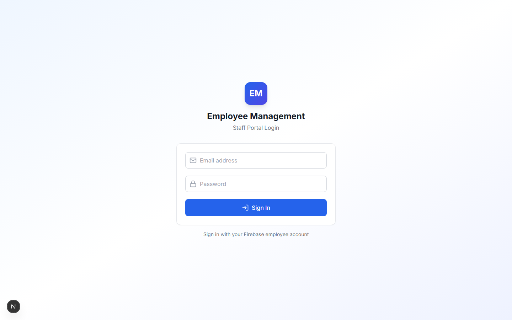
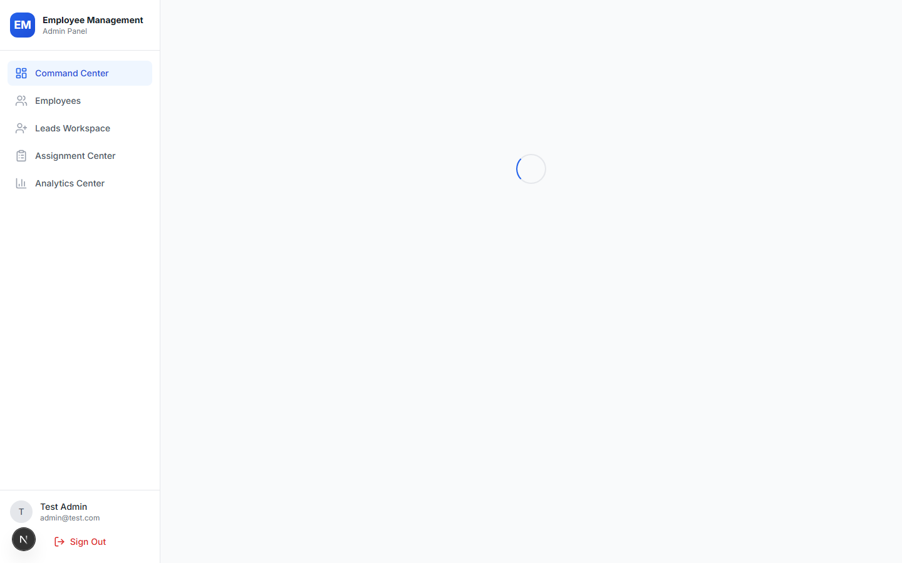
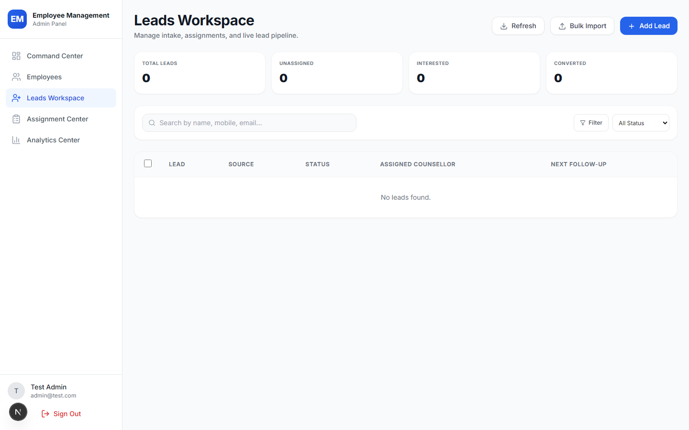
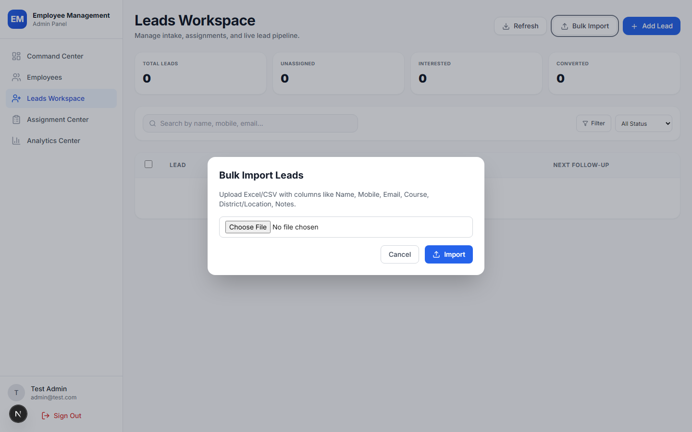
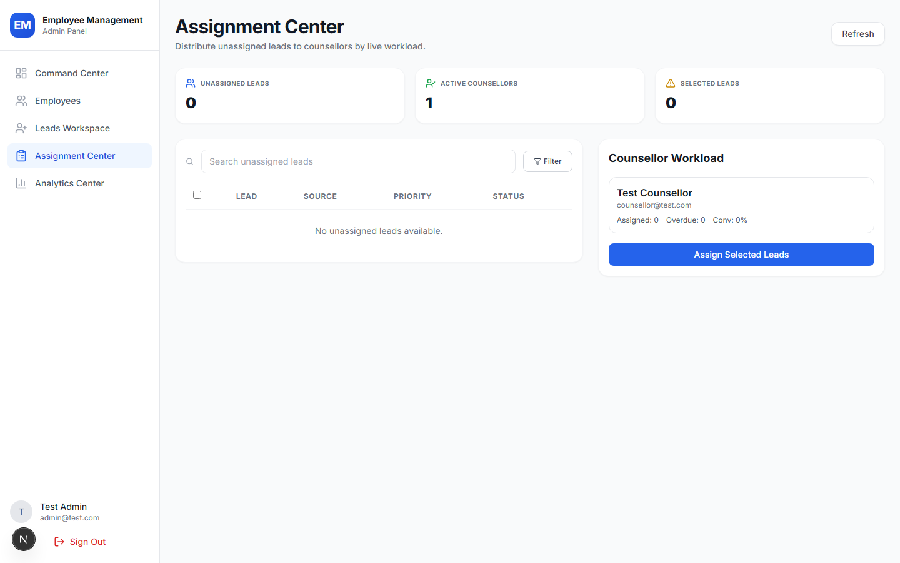
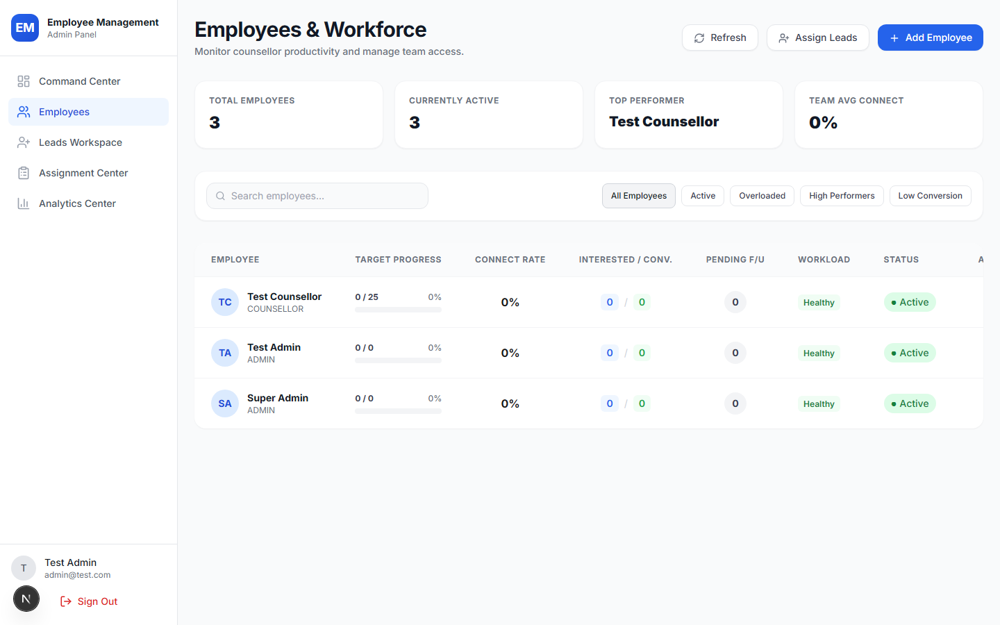
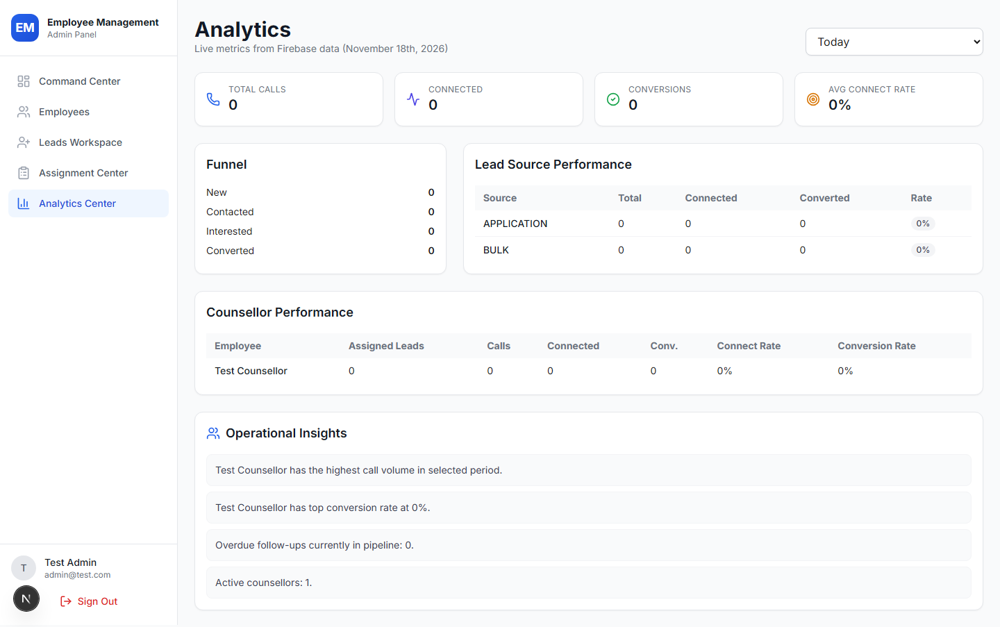
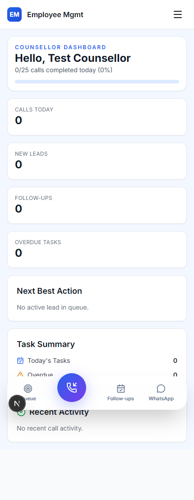
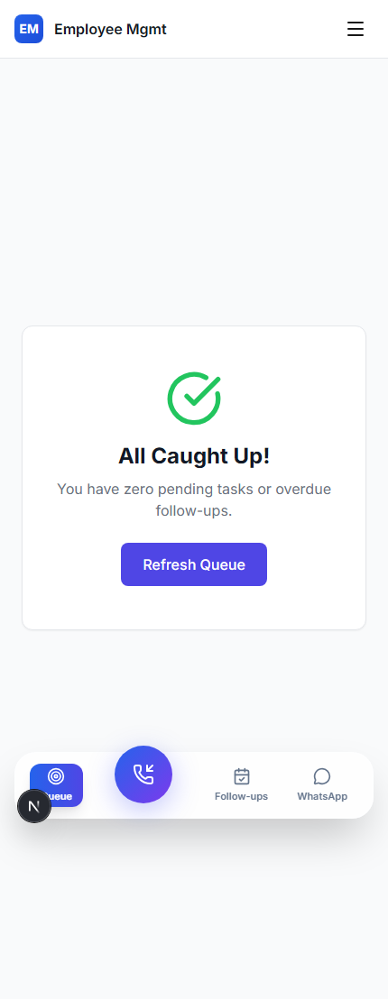
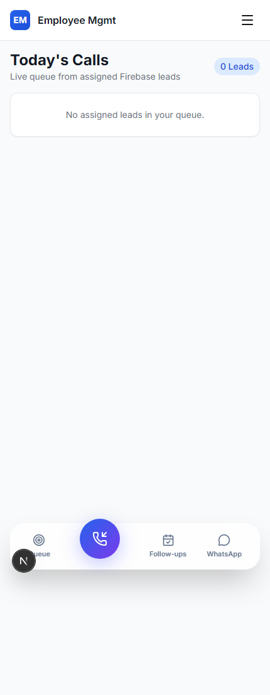

# Salem Foundations Admissions Portal — Official User Manual

Welcome to the **Salem Foundations Admissions & Telecalling Portal** user manual. This guide is written in clear, non-technical language to help institutional administrators, admission officers, and educational counsellors get the most out of the system.

---

## Table of Contents
1. [Getting Started & Login](#1-getting-started--login)
2. [Navigation & Role Layouts](#2-navigation--role-layouts)
3. [Administrator Guide](#3-administrator-guide)
   - [3.1 Executive Dashboard](#31-executive-dashboard)
   - [3.2 Lead Import & Management](#32-lead-import--management)
   - [3.3 Leads Assignment Center](#33-leads-assignment-center)
   - [3.4 Employee List & Staff Management](#34-employee-list--staff-management)
   - [3.5 Analytics & MIS PDF Report Generator](#35-analytics--mis-pdf-report-generator)
   - [3.6 WhatsApp Template Management](#36-whatsapp-template-management)
   - [3.7 Administrator Profile & Sign Out](#37-administrator-profile--sign-out)
4. [Educational Counsellor Guide](#4-educational-counsellor-guide)
   - [4.1 Counsellor Dashboard](#41-counsellor-dashboard)
   - [4.2 Telecalling Workspace & Dialer](#42-telecalling-workspace--dialer)
   - [4.3 Post-Call Outcome & WhatsApp Collateral](#43-post-call-outcome--whatsapp-collateral)
   - [4.4 Daily Schedule & Today's Calls](#44-daily-schedule--todays-calls)
   - [4.5 Follow-ups Management](#45-follow-ups-management)
   - [4.6 New Leads Discovery Pool](#46-new-leads-discovery-pool)
   - [4.7 Counsellor Profile & Sign Out](#47-counsellor-profile--sign-out)
5. [Frequently Asked Questions (FAQ)](#5-frequently-asked-questions-faq)
6. [Troubleshooting & Help](#6-troubleshooting--help)

---

## 1. Getting Started & Login

### What it does
The login system securely authenticates your identity and automatically redirects you to either the **Administrator Portal** or the **Counsellor Desk** depending on your assigned role.

### Step-by-Step Instructions
1. Open your web browser and navigate to the application URL (e.g., `http://localhost:3000` or your institutional domain).
2. A brief 2-second splash screen with the Oddmachine logo will greet you before transitioning smoothly to the sign-in form.
3. Enter your registered institutional **Email Address** (e.g., `admin@salemfoundations.org` or your counsellor email).
4. Enter your secure **Password**. You can click the eye icon to view or hide your password characters.
5. Click the blue **Sign In** button.
6. The system checks your profile and takes you immediately to your personal dashboard.

> [!TIP]
> If you are an administrator, you will arrive at `/admin/dashboard`. If you are an educational counsellor, you will land directly at `/counsellor/dashboard`.

---

## 2. Navigation & Role Layouts

### Desktop Sidebar Navigation
- **Top Brand Section**: Shows the Salem Foundations crest and current portal designation.
- **Navigation Links**:
  - **Admin Navigation**: Dashboard, Leads, Assignments, Employees, Analytics, WhatsApp, and Profile.
  - **Counsellor Navigation**: Home, Calls, Schedule, Follow-ups, New Leads, and Profile.
- **Notification Badges**: Dynamic pill counters alert counsellors to overdue tasks and upcoming calls today.

### Mobile Bottom Bar
When telecalling on mobile phones or tablets, counsellors enjoy a streamlined bottom touch dock providing one-tap access between **Home**, **Calls**, **Schedule**, and **Profile**.

---

## 3. Administrator Guide

### 3.1 Executive Dashboard

#### What it does
Provides a birds-eye operational overview of the entire admissions pipeline, key institutional metrics, and staff calling productivity.

#### Step-by-Step Instructions
1. Click **Dashboard** in the admin sidebar.
2. Review the top KPI cards:
   - **Total Leads**: Total student inquiries in the database.
   - **Assigned vs. Unassigned**: Inquiries already assigned to staff vs. waiting for distribution.
   - **High Priority**: Students flagged with urgent enrollment intent.
   - **Today's Calls**: Real-time tally of calls logged by all counsellors today.
   - **Converted**: Candidates who completed final admission confirmation.
3. Scroll down to review the **Admissions Funnel** chart to monitor student progression from inquiry to registration.
4. Review the **Staff Workload Snapshot** to see who is currently active on the phones.

---

### 3.2 Lead Import & Management

#### What it does
Allows administrators to upload student lists in bulk from school visits, fairs, or online campaigns via CSV or Excel (`.xlsx`), detect duplicate phone numbers, and manage candidate records.

#### Step-by-Step Instructions for Bulk Import
1. Navigate to **Leads** in the sidebar.
2. Click the green **Import Leads** button in the top-right corner.
3. In the upload popup, drag and drop your spreadsheet file (`.csv`, `.xlsx`, or `.xls`) or click **Browse Files**.
4. The system automatically inspects your columns:
   - Recognizes candidate names, mobile numbers, course preferences, and districts.
5. **Duplicate Detection Alert**:
   - If phone numbers in the file already exist in the database, the system halts and lists the duplicates.
   - Click **Review Duplicates** to inspect them.
   - Click **Remove Duplicates & Proceed** to safely discard repeats and import only fresh inquiries.
6. Click **Confirm Import**. The leads will appear in your lead pool immediately.

#### Step-by-Step Instructions for Adding a Single Lead
1. On the Leads page, click **Add Lead**.
2. Enter the student's **Full Name**, **Mobile Number**, **Alternate Phone** (optional), **Target Course** (e.g., *B.Tech Artificial Intelligence*), **District**, and **Source**.
3. Set the initial priority (`HIGH`, `MEDIUM`, or `LOW`).
4. Click **Save Lead**.

---

### 3.3 Leads Assignment Center

#### What it does
Distributes unassigned student leads among academic counsellors while monitoring the institutional average workload to prevent counsellor burnout.

#### Step-by-Step Instructions
1. Click **Assignments** in the sidebar.
2. Review the top metric card: Shows the balance format `(Assigned / Unassigned)`.
3. Notice the **Team Average Workload** indicator showing the target average per counsellor.
4. **Selecting Students (Left Column)**:
   - Check the boxes next to the students you want to assign.
   - You can click **Select All** to batch-select the entire filtered group.
5. **Selecting a Counsellor (Right Column)**:
   - Select exactly **one** counsellor from the list.
   - Check their status badge:
     - `Available` (Green): Below team average; ideal recipient for new leads.
     - `Balanced` (Blue): At or near the team average.
     - `Overloaded` (Amber): Above team average; consider assigning to others first.
6. Click the blue **Assign Selected Leads** button at the bottom.
7. To view prior assignments or reallocate leads, click the **Assignment History & Reassign** tab at the top.

---

### 3.4 Employee List & Staff Management

#### What it does
Manages the institutional roster of telecallers and counsellors, captures detailed personal records, adjusts calling targets, and handles account status.

#### Step-by-Step Instructions
1. Click **Employees** in the sidebar.
2. **Adding a New Staff Member**:
   - Click **Add Employee**.
   - Fill in: **Full Name**, **Institutional Email**, **Phone Number**, **Date of Birth (DOB)**, **Date of Joining**, and **Role** (`COUNSELLOR`).
   - Click **Save Employee**. The account is provisioned immediately.
3. **Viewing Detailed Staff Metrics**:
   - Click on any counsellor's row to open their detailed profile drawer.
   - View their total call time duration, lifetime completed calls, currently assigned student count, and recent activity log.
4. **Activating or Deactivating Staff**:
   - If a counsellor is active, click the amber **Deactivate** button to temporarily suspend their queue.
   - If a counsellor is inactive, click the green **Activate** button to restore their active status.
5. **Removing an Employee**:
   - Click the red **Remove Employee** trash icon.
   - Confirm deletion. The system automatically releases all of their assigned students back into the unassigned pool so no leads are lost.

---

### 3.5 Analytics & MIS PDF Report Generator

#### What it does
Generates operational charts and provides a 1-click downloadable, executive-ready PDF report formatted with institutional logos and confidentiality watermarks.

#### Step-by-Step Instructions
1. Click **Analytics** in the sidebar.
2. Use the date tabs at the top to filter data: `Today`, `Yesterday`, `Last 7 Days`, or `Last 30 Days`.
3. Inspect the graphical charts:
   - **Pipeline Conversion Velocity**: Shows how quickly leads move from raw stage to confirmed admissions.
   - **Lead Acquisition Channels**: Compares bulk imports, online inquiries, and campus walk-ins.
   - **Counsellor Productivity Leaderboard**: Ranks staff by completed calls, conversation duration, and conversions.
4. **Downloading the Official PDF Report**:
   - Click the blue **Download PDF Report** button in the top right.
   - The system builds a vector PDF featuring:
     - Salem Foundations crest on header left.
     - Oddmachine technology mark on header right.
     - Diagonal subtle watermark across every page.
     - KPI executive summary, distribution tables, and confidentiality notice.
   - The PDF downloads automatically to your device.

---

### 3.6 WhatsApp Template Management

#### What it does
Allows administrators to write and manage standard WhatsApp message templates that counsellors can send to students right after finishing a phone call.

#### Step-by-Step Instructions
1. Click **WhatsApp** in the admin sidebar.
2. View existing templates (e.g., *Course Prospectus*, *Fee Structure*, *Campus Visit Invitation*).
3. **Adding a New Template**:
   - Click **Add New Template**.
   - Enter a descriptive title (e.g., *Scholarship Eligibility & Deadlines*).
   - In the message body, write your text and click the tag chips to insert dynamic placeholders:
     - `{name}` → Automatically replaced with the candidate's real name.
     - `{course}` → Replaced with the candidate's course interest.
     - `{counsellorName}` → Replaced with the calling counsellor's name.
     - `{counsellorPhone}` → Replaced with the counsellor's callback number.
   - Click **Save Template**.
4. **Enabling/Disabling Templates**:
   - Use the green toggle switch on any template card.
   - When active, the template appears instantly in the counsellor telecalling console.

---

### 3.7 Administrator Profile & Sign Out

#### What it does
Displays the logged-in administrator's credentials and houses the secure session sign-out control.

#### Step-by-Step Instructions
1. Click **Profile** at the bottom of the admin sidebar.
2. Review your administrative identity (Email, Name, Role: `ADMIN`, UID).
3. To securely end your session, click the red **Sign Out** button at the bottom of the card.
4. You will be logged out and returned to the sign-in screen.

---

## 4. Educational Counsellor Guide

### 4.1 Counsellor Dashboard

#### What it does
Your daily home base. Displays your assigned workload, calling targets, and urgent follow-up notifications.

#### Step-by-Step Instructions
1. Review your top cards upon signing in:
   - **Calls Today**: Number of phone calls you have logged today.
   - **Daily Target**: Your workload-adaptive target for the day.
   - **Overdue Callbacks**: Immediate callbacks requiring urgent attention.
   - **Due Today**: Scheduled appointments for today.
2. Click the large blue **Start Telecalling** button to immediately jump into your priority queue.

---

### 4.2 Telecalling Workspace & Live Dialer

#### What it does
The primary calling console. Serves the most important student next, opens your phone dialer, times your call, and records the conversation.

#### Step-by-Step Instructions
1. When you enter **Calls**, the system automatically presents your highest-priority student (Overdue callbacks first, then today's callbacks, followed by fresh inquiries).
2. Review the candidate card:
   - Student Name and Contact Number.
   - Target Program (e.g., *B.Tech Computer Science*).
   - District/Town (e.g., *Salem*, *Namakkal*).
   - Previous conversation history and counsellor notes.
3. **Placing the Call**:
   - Click the green **Call Student Now** button.
   - Your device's dialer opens automatically with the number loaded.
4. **During the Call**:
   - Click **Candidate Answered → Start Timer**.
   - A live stopwatch tracks your talk time.
5. **Ending the Call**:
   - When your conversation concludes, click the red **End Call & Record Outcome** button.
   - This immediately transitions you to the post-call disposition form.

---

### 4.3 Post-Call Outcome & WhatsApp Collateral

#### What it does
Captures the result of your phone call, schedules required follow-ups, records notes, and allows you to optionally send an instant WhatsApp follow-up.

#### Step-by-Step Instructions
1. **Select Strict Outcome**:
   - Click one of the six standard outcome buttons:
     - `Interested`: Student wants admission or more details.
     - `Call Later`: Student asked for a callback at a specific time.
     - `No Response`: Phone rang or was busy.
     - `Not Interested`: Student declined or enrolled elsewhere.
     - `Wrong Number`: Contact number invalid.
     - `Converted`: Student confirmed admission / paid registration fee.
2. **Schedule Follow-Up (Mandatory for Interested & Call Later)**:
   - Click a quick preset (`Later Today +3h`, `Tomorrow 10 AM`, `In 2 Days`, `Next Week`) or pick a custom date and time.
3. **Record Discussion Notes (Mandatory)**:
   - Type a concise summary of what was discussed (e.g., *Parent inquired about hostel fees; promised to visit campus on Saturday*).
4. **Send WhatsApp Collateral (Optional)**:
   - Directly under the notes, find **4. WhatsApp Follow-Up Message (Optional)**.
   - By default, **None (Skip)** is selected.
   - To send collateral, click any active template chip (e.g., *Course Prospectus* or *Campus Visit Invitation*).
   - A live green preview box appears showing the personalized message with the student's name and course already filled in.
   - Click **Send via WhatsApp** to open the chat immediately in a new tab, or simply leave it selected.
5. **Save Outcome**:
   - Click **Save Outcome & Load Next Lead**.
   - If a WhatsApp template was selected and not yet sent, the system automatically opens WhatsApp in a new tab while saving your notes and seamlessly presenting your next student.

---

### 4.4 Daily Schedule & Today's Calls

#### What it does
A categorized list of all student calls scheduled for your attention today.

#### Step-by-Step Instructions
1. Click **Schedule** in the counsellor menu.
2. Switch between the tabs:
   - **Overdue**: Calls whose scheduled callback time has passed. Address these first!
   - **Upcoming Today**: Appointments scheduled for later today.
   - **Completed**: Calls you have already concluded today.
3. Click the phone icon on any row to open the student directly in your workspace.

---

### 4.5 Follow-ups Management

#### What it does
Organizes all candidates requiring callbacks across the upcoming week or month, helping you prepare for campus visits and application deadlines.

---

### 4.6 New Leads Discovery Pool

#### What it does
Displays all fresh, uncontacted student inquiries currently assigned to you. Perfect for finding candidates when you have completed all scheduled callbacks early.

---

### 4.7 Counsellor Profile & Sign Out

#### What it does
Displays your employee information, daily target metrics, and secure sign-out option.

#### Step-by-Step Instructions
1. Click **Profile** in the sidebar (or bottom bar on mobile).
2. Review your staff information (Name, Role: `COUNSELLOR`, Assigned Department).
3. To finish your shift, click the red **Sign Out** button.

---

## 5. Frequently Asked Questions (FAQ)

### Q1: Why did the system prevent me from placing a call at 8:30 AM?
> **Answer**: The system enforces regulatory calling hours between **09:00 AM and 06:00 PM (18:00)** to ensure institutional compliance and student convenience. Dialing outside these hours is restricted.

### Q2: What happens if a student does not answer the phone?
> **Answer**: Select **No Response**. The system's automatic retry engine will intelligently reschedule the student for a retry attempt after 2 hours (exponential backoff). If a student fails to answer after 3 attempts, the lead is closed to preserve counsellor time.

### Q3: What happens when an employee leaves or is removed?
> **Answer**: When an administrator deletes an employee, the system uses a safe cascading unassignment. All leads assigned to that employee are automatically placed back in the **Unassigned Pool** so they can be redistributed without data loss.

### Q4: Can I send a custom WhatsApp message instead of a template?
> **Answer**: To maintain institutional brand standards, counsellors choose from pre-approved templates created by administrators. However, once the message opens in WhatsApp, you can append custom clarifications before pressing send.

### Q5: Can multiple counsellors be assigned to one student?
> **Answer**: No. Every student lead is strictly assigned to **one counsellor** at a time to ensure personal accountability and eliminate duplicate phone calls to parents.

---

## 6. Troubleshooting & Help

| Issue | Cause | Solution |
| :--- | :--- | :--- |
| **"Invalid email or password"** | Incorrect credentials typed at login. | Verify Caps Lock is off. Contact your system administrator to confirm your institutional email. |
| **WhatsApp web does not open** | Browser pop-up blocker active. | Look at the right corner of your browser address bar and choose **"Always allow pop-ups from this site"**. |
| **"Please select follow-up date"** | Selected `Interested` or `Call Later` without picking a time. | Choose one of the quick preset buttons (`Later Today`, `Tomorrow 10 AM`, etc.) before clicking Save. |
| **Phone number doesn't dial** | On a desktop PC without a softphone app. | Install Skype, Microsoft Phone Link, or WhatsApp Desktop, or access the counsellor portal on your mobile device browser. |
| **Report PDF won't download** | Browser download permissions blocked. | Check browser downloads bar and ensure permission is granted for PDF exports. |

For technical assistance or system credential resets, contact the **Salem Foundations IT & Operations Helpdesk**.
